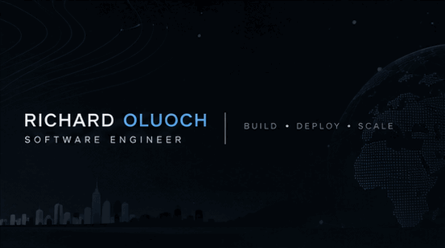

# Richard Oluoch

  

 

**Software Engineer · Backend Development · Systems Engineering**

I build reliable software, backend services, and practical systems. My interests include distributed architectures, geospatial applications, Linux, and self-hosted infrastructure.

---

### Selected Projects

**[Bus Tracking & Seat Reservation](https://github.com/autoUnmask/Bus-tracking)**

A real-time public transport tracking and seat reservation system designed around Nairobi's transit ecosystem.

`Go` `React` `PostgreSQL` `PostGIS` `Valkey` `Docker`

**[CBC Portal for Schools](https://github.com/autoUnmask/CBC-portal-For-Schools)**

A school management platform supporting student records, academic grading, and reporting within Kenya's Competency Based Curriculum framework.

`PHP` `MySQL`

**NixOS Flakes**

A declarative Linux configuration built around NixOS, featuring modular system configuration, reproducible environments, and a customised Hyprland desktop.

`Nix` `NixOS` `Hyprland` `Linux`

---

### Technologies & Tools

**Languages**

  

**Development**

  

**Databases & Infrastructure**

  

**Self-hosting & Systems**

  

---

### Connect

[GitHub](https://github.com/autoUnmask) · [Email](mailto:richardoluoch2015@outlook.com)

